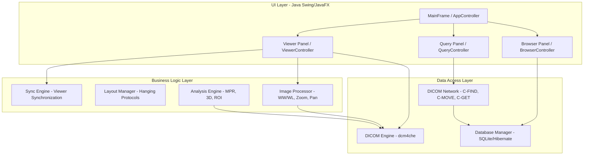

# OculusJJ Porting Guide

---

**最終更新日:** 2026-07-30

---
# Horos 主要モジュール構成図 (Java移植リファレンス)

## 1. ハイレベル・アーキテクチャ・マップ

## 2. モジュール詳細とJavaへのマッピング

| Horos モジュール (Obj-C) | Java 移植先/推奨実装 | 役割と重要点 | 参照すべき old-docs |
| :--- | :--- | :--- | :--- |
| **AppController** | `ApplicationContext` / `MainFrame` | 全体管理。シングルトンパターンで実装。 | `00-Project-Overview.md` |
| **BrowserController** | `StudyBrowserViewModel` / `BrowserPanel` | 患者・検査ツリーの管理。`DicomStudy` 階層の管理。 | `05-Database-Management.md` |
| **ViewerController** | `ImageViewerController` / `ViewportManager` | ビューアの核。ピクセル表示、WW/WL、同期の司令塔。 | `06-UI-Components-ViewerController-Complete.md` |
| **DCMView / DCMPix** | `DicomCanvas` / `PixelBuffer` | 実際の描画。`BufferedImage` や `OpenGL` (JOGL) を使用。 | `03-Image-Display-Rendering.md`, `HOROS_PIXEL_DATA_ANALYSIS.md` |
| **DicomDatabase** | `StudyRepository` / `SQLiteService` | SQLiteによるメタデータ管理。dcm4cheのモデルと連携。 | `HOROS_DB_FLOW_ANALYSIS.md` |
| **QueryController** | `DicomNetworkService` | PACSへの問い合わせと転送。dcm4che-netを使用。 | `04-DICOM-Network-Communication.md` |
| **Sync Engine** | `ViewerSyncManager` | 複数ビューアの座標・ウィンドウレベル同期。 | `HOROS_SYNC_COMPLETE_REFERENCE.md` |
| **MPR/3D Controllers** | `VolumeRenderingEngine` | 3D再構成ロジック。VTKのJavaラッパーまたは独自実装。 | `11-MPR-3D-Image-Generation.md` |

## 3. 移植における最重要課題 (Critical Path)

### 3.1 ピクセルデータのハンドリング
- **課題**: `DCMPix` の極めて効率的なメモリ管理の再現。
- **対策**: Javaでは `DirectByteBuffer` を活用し、オフヒープメモリでピクセルデータを管理し、GCの負荷を最小限に抑える。

### 3.2 同期ロジックの再現
- **課題**: 複雑な同期フラグとイベントタイミングの正確な移植。
- **対策**: `HOROS_SYNC_ANALYSIS.md` に基づき、状態遷移図を定義した上でイベントバス形式で実装する。

### 3.3 UIレイアウトの柔軟性
- **課題**: Cocoa XIBによる動的なビューア配置の再現。
- **対策**: `JSplitPane` や `GridBagLayout` の組み合わせによる実装。`38-Java-Swing-JSplitPane-Issues.md` の教訓を反映。
