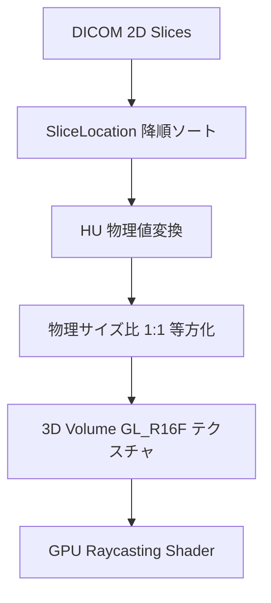

# DICOM レンダリング・パイプライン実装仕様書 (Java Porting)

## 1. 概要
本ドキュメントは、OculusJJにおける2D/3D画像のレンダリングパイプラインを定義する。
HOROS-20240407の高速なメモリアクセスと数理精度を再現し、dcm4cheの自動処理に依存しない低レイヤーでのピクセル制御と、3Dボリュームレンダリングへの統合パイプラインを策定する。

---

## 2. 2D 処理フロー (Image Rendering Pipeline)

画像データは以下の4ステップで変換され、最終的に画面に描画される。

### Step 1: Raw Pixel Data 読み込み
- **処理**: `dcm4che-core` を用いて、DICOM ファイルの生バイトから `PixelData` タグ `(7FE0,0010)` をロード。
- **最適化**: マルチスライスのロード時、ヒープの断片化とGC停止（STW）を避けるため、不要になった中間ピクセルバッファはロード完了後に即座に null 化し強制GCを掛けるメモリ管理戦略を適用。

### Step 2: fImage 生成 (32-bit/16-bit 物理 HU 変換)
- **目的**: 高精度な位置決め計算と、Rescale Slope/Intercept の正確な適用。
- **計算式**: 生ボクセル値 $R$ に対し、DICOMタグの `Rescale Slope (0028,1053)` $S$ と `Rescale Intercept (0028,1052)` $I$ を適用して Hounsfield Unit (HU) 物理値 $HU$ を算出。
  $$HU = (R \times S) + I$$

### Step 3: Window Level / Window Width (WL/WW) 適用
- **目的**: 物理値 $HU$ をディスプレイ表示可能な 8-bit (0-255) グレースケールにマッピングする。
- **マッピング式**:
  - **窓下限値**: $W_{low} = WL - WW / 2$
  - **窓上限値**: $W_{high} = WL + WW / 2$
  - **8-bit変換**: 
    $$V_{8bit} = \text{clamp}\left( \frac{HU - W_{low}}{WW} \times 255, 0, 255 \right)$$

### Step 4: BufferedImage / baseAddr 生成
- **結果**: 最適化された `BufferedImage.TYPE_BYTE_GRAY` として書き出し、Java Swingの描画コンポーネントまたはテクスチャへ高速転送。

---

## 3. 3D ボリュームレンダリングへの統合パイプライン (3D Volume Integration Pipeline)

2Dスライスの集合から 3D 空間モデルを構築し、GPU/CPU レンダラーへ転送するまでの拡張パイプライン。

### Step 1: 空間スライスソート (Spatial Alignment)
- **処理**: 各 DICOM スライスの `SliceLocation (0020,1041)` 値を取得し、降順（大 $ \to $ 小、頭側 $ \to $ 足側）でソート。
- **効果**: 前後・上下左右の方向定義を HOROS と 100% 同一に揃え、画像の反転や捻れを完全に排除。

### Step 2: 3D ボリューム構築
- **処理**: ソートされたスライスから物理値 $HU$ を計算し、フラットな `short[]` 3D 配列（`volume = new short[dimZ * dimY * dimX]`）に集約。
- **アスペクト比補正**: `PixelSpacing` と `SliceThickness` の絶対値差分から各軸の物理 mm 幅を計算し、モデル行列のスケール係数 `voxScaleX`, `voxScaleY`, `voxScaleZ` を算出。

### Step 3: GPU テクスチャ転送 (GPU Upload Pipeline)
1. **GL_TEXTURE_3D (Volume)**: 構築された 16-bit 符号付き $HU$ データを `GL_R16F` (16-bit 浮動小数点数シングルチャンネル) 形式で GPU 上にアロケート。
2. **GL_TEXTURE_3D (Gradients)**: 3D Sobel フィルタを用いて三次元輝度勾配（$dx, dy, dz$）を計算し、`GL_RGBA8` 形式で転送（法線ベクトルとしてサンプリング）。
3. **GL_TEXTURE_1D (Transfer Function)**: カラーおよび不透明度のマッピング配列を `GL_RGBA16F` テクスチャとしてバインド。

---

## 4. 2D / 3D 幾何・座標メタデータ管理

幾何学的整合性を担保するため、以下のタグをパイプライン全体で一貫して引き継ぐ。

| 幾何属性 | DICOMタグ | 役割と影響 |
| :--- | :--- | :--- |
| **Pixel Spacing** | `(0028,0030)` | 2D計測、および3Dのアスペクト比補正の基礎スケール。 |
| **Image Position Patient** | `(0020,0032)` | 物理ワールド原点 $\mathbf{O}$ の定義。MPRの断面切り出しの基準。 |
| **Image Orientation Patient** | `(0020,0037)` | 物理方向ベクトル $\mathbf{I, J}$。カメラ回転時のパニング射影補正に適用。 |
| **Slice Location / Thickness** | `(0020,1041)` | Z軸方向のボクセルピッチ計算。 |

---

## 5. 技術的最適化とメモリ戦略

1. **オフヒープ及びGC適正化**: 3Dボリューム変換時に中間生成されるスライスの `short[]` 生データは、3D配列へのコピー完了後、即座に null 化して参照を破棄。100スライスごとに `System.gc()` を呼び出すことで JVM ヒープをクリアに維持。
2. **シェーダー内 HU スケール高速化**: Raycasting シェーダー内でテクスチャ値を Hounsfield Unit に変換する際、`GL_R16F` テクスチャから読んだ `0.0`〜`1.0` の値を `raw = tex * 65535.0 - 32768.0` で物理空間値へ直接展開し、演算速度を最大化。
